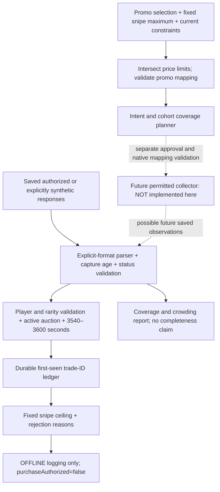

# Research-led fresh-listing discovery: audit and offline prototype

**Outcome:** a concrete search-price configuration gap is demonstrated in current FC Enhancer production functions, and a read-only offline evaluator is supplied. No FC Enhancer extension was changed, no EA market search or purchase was executed, and no live fresh-listing success is claimed.

## 1. Source record and evidence quality

### Read: community API reference

Repository: https://github.com/AbdoD97/fut-web-app-api

Pinned revision: `ad9a5f9384c3a80a6c00f33c14ca9cbd344c4aba`, commit dated 2026-03-08. Its title is **EA FC 26 Ultimate Team — REST API Reference**. It identifies itself as unofficial and distinguishes observed FC26 findings from community findings. It is not an official EA contract or FC27 compatibility proof.

Relevant pinned links:

- [Transfer-market parameters and response example](https://github.com/AbdoD97/fut-web-app-api/blob/ad9a5f9384c3a80a6c00f33c14ca9cbd344c4aba/README.md#transfer-market): `maxb`, `minb`, `rarityIds`, `auctionInfo`, `tradeId`, `buyNowPrice`, `currentBid`, `expires`.
- [JS item and search DTO representations](https://github.com/AbdoD97/fut-web-app-api/blob/ad9a5f9384c3a80a6c00f33c14ca9cbd344c4aba/README.md#data-structures): `rareflag`, `_auction`, `defId`, `rarities`, `maxBuy`, `minBuy`; expires is described as seconds remaining.
- [Player/concept search](https://github.com/AbdoD97/fut-web-app-api/blob/ad9a5f9384c3a80a6c00f33c14ca9cbd344c4aba/README.md#player--concept-search): a possible identity-metadata lead, not a verified complete Ultimate Scream roster.

Important source conflicts/limits:

1. It illustrates offsets 0,21,42; supplied FC27 logs instead show 0,20,380 with num=21. Do not hardcode its offset stride.
2. It says a player identity is required for player searches; the supplied broad-filter live observations returned many different players. Do not require manual player selection based on this statement.
3. Its generic special/promo example rarity 55 is **not** verified as the FC27 Ultimate Scream rarity. The offline fixture ID 4242 is deliberately synthetic and is not a real promo mapping.
4. No demonstrated server newest-first request option is provided. Sorting a returned array locally cannot retrieve omitted listings.
5. No session/authentication/rate-limit recommendations from that document were used to send market requests. The task remained offline/read-only.

### Not read: two supplied guide leads

- https://futsplash.com/guides/fc-27-sniping-filters
- https://fcautobuyer.com/news/how-does-an-fc-autobuyer-work/

Both read-only fetch attempts were rejected by the current proxy with CONNECT response 403 / origin HTTP 000 before receiving the article. Their content, accuracy, publication dates and FC27 claims have **not** been verified. The user's summaries remain investigation leads, not findings attributed to the articles. These failures do not establish that either site is offline or returns 403 itself.

A draft adding only `futsplash.com` and `fcautobuyer.com` was saved, preserving the three previously requested historical script hosts and package-manager presets. The running allowlist still does not grant those destinations. The environment tool reports requires_publish=true: activation needs user review/save and publication. Nothing was published by the agent. Saved page text is an alternative that does not require changing the environment.

### Read: current FC Enhancer production source

Audited the v7.2 production bundle corresponding to GitHub commit `f40413e7a19e8753bc1cc970b4c63ae754a20cda`:

- Extension ZIP: `FC_Enhancer_v7_2_Pagination_Recovery_TEST.zip`, SHA-256 `ab11022dd5340023455375705c799081fdcc186aa6c5fb5521c1cf02d5a433e8`.
- `js/main.js`: SHA-256 `ed00ac0976812d6d28bf4f5231625b0c55c32b3e420772d502717d02e5811ac2`.
- [Existing ZIP source location](https://github.com/ihtishamkayani691-gif/fc27/blob/f40413e7a19e8753bc1cc970b4c63ae754a20cda/delivery/FC_Enhancer_v7_2_Pagination_Recovery_TEST.zip).

Exact extracted production modules and a portable offline audit runner are in `audit/`. Browser/search/purchase dependencies are stubbed in that runner. The extension entrypoint and native market service are not executed.

## 2. Workstream A: current adapter audit

| Concept | Actual current representation | Relevant path |
|---|---|---|
| Selected market rarity | `controller.viewmodel.searchCriteria.rarities`; effective multi-rarity selection fills it only when defId/rarities are empty | 61400 -> 99007; legacy override 30501 |
| Returned card rarity | `item.rareflag`; raw REST reference uses `itemData.cardsubtypeid` | 1814/30501 and community JS/REST representations |
| Search maximum BIN | `searchCriteria.maxBuy`, copied/passed through to `services.Item.searchTransferMarket(criteria,page)` | 61400, 99007, 65757, 33147 |
| Buy/Bid Settings maximum | `traderSettings.buySetting.buyPrice` | UI module 79221; evaluation modules 7520/30804/83847 |
| Remaining seconds | `item.getAuctionData().expires` / serialized `_auction.expires` | 99007, 7520; current supplied logs show seconds |
| Trade identity | Auction `tradeId`, not player name/definition ID | 99007 identity checking; existing bid cache paths |
| Market result collection | Native JS service returns `data.items`; actual HTTP REST body is external to this bundle | 33147/83195/65757 |
| Raw-before-client-filter view | index.js capture hook stores a pre-RXe array when available | index CXe; 99007.raw |
| Client-filtered collection | May have fewer or zero entries even when pre-filter collection is populated | index RXe and main filterResult |
| Count | Array length and optional observed request count; no full-market total established | 65757/65685/3434/99007 |

The conversion from native DTO `maxBuy`/`rarities` to wire `maxb`/`rarityIds` happens inside external EA code, absent from the extension. The community mapping supports a research hypothesis; a numeric-only permitted observation is needed to establish the FC27 wire mapping. The existing diagnostics mainly capture pagination fields, so absence of maxb in those logs is not proof the actual request omitted it.

### Demonstrated gap: search maximum and buying maximum are independent

The normal Buy/Bid Settings callback (79221) sets `buySetting.buyPrice`. The broad Trader run (61400) gets the controller's searchCriteria; the helper (99007) copies that DTO without imposing buySetting.buyPrice. The pre-search price validator (58104) checks that some price mode is configured but does not assign criteria.maxBuy. The adapter (33147) forwards that criteria unchanged.

Actual production-function audit results with buySetting.buyPrice=400,000:

| Controller's market maxBuy | Outgoing criteria.maxBuy observed by the offline stub |
|---|---|
| Absent | Absent |
| 250,000 | 250,000 |
| 900,000 | 900,000 |

The original post-result `checkBuyPrice` (30804) rejects a returned 500,000 BIN against a calculated maximum of 400,000 and accepts equality at 400,000. These are five executed offline audit assertions, not a live wire capture.

There are exceptions: `snipeWithTrader` (1814), the existing single-card helper, explicitly sets both `g.searchCriteria.maxBuy=u` and `p.buySetting.buyPrice=u`. A user may also independently set the native market-filter maximum. This is why the finding is conditional: setting only the Buy/Bid maximum does not constrain broad retrieval, but not every current search is necessarily unbounded.

**Your supplied screenshots also show a 400,000 native market maximum. Therefore this code gap alone is not a proved cause of those particular live results.** Both ceilings may have been set. Permitted wire/DTO evidence is needed to distinguish the cases.

Another distinction: when real-time BIN pricing is enabled, 7520 uses the dynamically calculated value rather than the static buyPrice. A new user snipe maximum should be an additional hard cap; it must not replace or relax a stricter dynamic/profitability limit.

Current Auto-Find also largely relies on the query's rarity selection rather than positively checking each result's rareflag against the selected promo. Legacy ignore-rarity filters are a different mechanism. The offline evaluator adds explicit per-record rarity validation without claiming that the existing live filter was broken.

## 3. Why broad searches can return near-expired cards

Established observations: the supplied screenshots show returned durations such as 18–27s or 43–52s, full arrays of 21 entries, and target=0. Those records are not within 3540–3600 seconds. The current time gate already uses the minute-sized window; this is not evidence of a 59-second conversion mistake.

Evidence-supported explanation, with limits:

- A broad promo query can compete for a finite returned set. A result count equal to the observed requested capacity is evidence of possible crowding, not proof of truncation or total market size.
- If the search price cap is absent or looser than the intended snipe price, unsuitable higher-priced listings can occupy that returned set. Rejecting them afterward protects eligibility but cannot recover suitable listings omitted by retrieval.
- Even a correctly applied maximum price does not specify freshness. Many price-eligible older listings may still fill the response.
- Client filtering, cached responses, mutable market contents and native search behavior can affect what is seen. No specific one is proved as the single cause by the supplied screenshots.
- There is no demonstrated newest-first server sort in the examined integration. A local display sort or successful HTTP status cannot create missing fresh results.

Do not infer a guaranteed global ordering from the sample's near-expired cards, or from manual page observations. The offline prototype evaluates every returned record and reports only this snapshot's observed ordering.

## 4. Workstream B: price-constrained searches and smaller groups

### Price before retrieval, price again after retrieval

Proposed native integration contract (not applied to any live service here):

```
effectiveSearchMaximum = min(valid existing search maximum,
                             configured fixed snipe maximum)
```

An unset/Any search maximum would receive the fixed snipe maximum. A tighter existing maximum and the existing minimum/rarity/league/etc. constraints are preserved. An empty minimum/maximum intersection is reported instead of silently widening the query. A future native adapter must use the current UI-supported fields and native valid-price rounding downward; the offline prototype does not invent price-tier rules or endpoints.

After retrieval, enforce the fixed snipe ceiling again, then retain the original stricter dynamic pricing/profitability/balance/budget/duplicate/expiration/purchase protections. Data anomalies or a misapplied server filter must not bypass the local ceiling. The offline evaluator never executes those original purchasing paths and labels them pending.

### Smaller groups: a research design, not proven coverage

A complete, current, independently checked roster of eligible promo CARD identities could permit internally scheduled cohorts. The user would choose the promo/maximum, not individual players. Cohorts must cover every supplied eligible card, including multiple versions where relevant, and rotate fairly without starving expensive or newly added players.

Important unresolved prerequisite: an array-valued defId field does not prove native multi-ID OR searches are supported. The reference's player-identity requirements and actual native full/masked-ID semantics are not consistent enough to issue guessed group requests. The offline planner therefore returns only conceptual cohorts and sets executableRequest=false. A future approved collector may need individually mapped native player searches internally; it must establish the mapping and completeness first.

Keep a broad price-constrained backstop as an investigated coverage path, because a stale roster could omit a new promo player. The evaluator surfaces a valid selected-rarity card outside its supplied roster instead of silently dropping it, and reports the coverage gap. In a declared narrow cohort, a response for a different full definition ID is rejected as a scope mismatch.

Separate these metrics:

1. Cards assigned to the conceptual plan.
2. Declared queried-player intent in supplied snapshots.
3. Card identities actually observed in those snapshots.
4. Full current live-market coverage: **not established** by any of the above.

Cohort coverage also has a timing limit. If there are N independently queried scopes and the already-permitted spacing is d seconds, a full revisit cycle takes at least N*d seconds, plus response/pause time. A hypothetical 12 scopes at 10 seconds each takes at least 120 seconds, longer than the 60-second target band. This is an illustrative bound, not a request-rate recommendation. Fair coverage of every eligible player is different from seeing every listing during the window. Do not increase request rates or weaken safety rules to hide a cadence/coverage shortfall.

If even a single-player/price-constrained result remains crowded, completeness is still unresolved. Do not hide it with an endless adjustment loop or claim first-page freshness.

### Offline counterexamples

Two explicitly synthetic fixtures are supplied:

- `synthetic-price-crowding.json`: an intentionally fixed-order finite list illustrates the difference between filtering BEFORE a two-record cap and rejecting overpriced records AFTER the cap. The latter returns no suitable record; the former exposes a synthetic 3559-second, 80,000 BIN record. This is a mathematical counterexample, NOT a model or prediction of EA's ranking/filter implementation.
- `synthetic-market.json`: a crowded synthetic broad response contains near-expired items; supplied narrower-cohort responses contain one new in-window affordable trade, an overpriced trade, an already-seen trade, another new trade, and a wrong-rarity trade. The evaluator distinguishes them correctly. Supplying a narrower fixture does not prove EA would produce it.

These establish evaluator behavior and why retrieval design matters. They do not establish any successful fresh discovery on FC27.

## 5. Workstream C: historical PenguBOT investigation

The earlier supplied archives were inspected and decoded. They inject external script.js files; their nine bundled first-party scripts do not establish the market-discovery algorithm. The public script hosts are still outside the current running allowlist. The saved network draft retains those requested hosts; no credentials, license values or external login/notification operations were used.

The independent audit/evaluator work proceeded without waiting for those scripts. No claim is made that PenguBOT used the cohort or price-partition proposal. Its actual search implementation remains unknown until the authorized external source is available. See PENGUBOT_STATUS.md for the short loader evidence.

## 6. Proposed fresh-discovery architecture



Future live collection is deliberately separate from offline eligibility. No service implementation or timer from the old page-centered feature is wired into this prototype. No sorting, pagination, cache invalidation or request-rate behavior is assumed.

Future integration must preserve original safety middleware as additional gates and keep native purchase/bid entry points disabled during a permitted logging-only trial. Validating discovery and enabling purchasing are separate approvals and separate acceptance tests.

## 7. Workstream D: offline prototype

Run on Node.js 20+ (tested on 24.19.0), with no npm installation:

```
node offline/evaluator.test.cjs
node audit/run-audit.cjs
node offline/cli.cjs offline/fixtures/synthetic-market.json --replay
node offline/cli.cjs offline/fixtures/synthetic-price-crowding.json --replay
```

The CLI reads JSON from disk and writes JSON to stdout. It has no network, browser, bid, purchase or scheduler integration. Without --replay it evaluates saved captures at the current clock; old captures become stale. Replay uses explicit fixture timestamps and is labeled offline-replay, not current market evidence.

Implemented safeguards/limits:

- Explicit adapters for saved REST `auctionInfo`, serialized FC-model `items`, and normalized `listings`; no silent empty fallback on malformed data.
- Exact 3540/3600 inclusive boundaries; 59/30 seconds and millisecond/absolute timestamps are not treated as fresh seconds.
- Capture-age subtraction and a default 15-second maximum snapshot age; invalid/future/non-monotonic timestamps fail closed. The age threshold is an offline policy, not a discovered EA guarantee.
- Positive integer snipe ceiling, selected numeric rarity IDs, active player auctions, positive BIN and valid bid data required.
- Trade IDs are distinct from player identities. Decimal strings preserve large IDs; unsafe numeric IDs are rejected instead of silently rounded.
- Previously seen trades remain seen even if earlier rejected for price/age/rarity. Export/import preserves dedup history. Memory capacity halts the evaluator instead of forgetting old trades and calling them new again.
- Expired/closed/malformed/wrong-rarity/duplicate/overpriced records receive explicit rejection reasons.
- Crowd flags use the supplied observed request count, not a hardcoded 21. A below-cap result is not declared complete; missing capacity metadata stays unknown.
- Source fields such as headers/cookies/unknown data are not copied to logs or persisted state. Player-name control characters are sanitized.
- Every result has liveSuccess=false and purchaseAuthorized=false. SnipeEligible means only offline identity/fresh-window/rarity/state/price screening, with originalSafetyPending=true.

FirstSeenAt is the first captured observation available to this evaluator. A near-one-hour remaining timer plus first-seen status is a candidate heuristic, not authoritative listing birth time: a longer auction can also eventually have one hour remaining. Reliable creation/original-duration metadata would be needed for a stronger claim.

## 8. Validation results

- 47 offline evaluator regression tests passed; 0 failed/skipped.
- 5 production audit assertions passed, using actual extracted current production functions with external dependencies stubbed.
- Both synthetic CLI fixtures executed and their outputs are supplied.
- Source syntax/package integrity and untouched extension hashes are recorded separately in VERIFICATION.json.
- No actual EA requests, purchases, bids, account login or live discovery observations occurred.

## 9. Explicit unverified-on-live-FC27 list

1. Actual selected Ultimate Scream rarity ID(s), their wire mapping, and positive matching on returned cards.
2. Whether the user's search already includes the intended maxb, and how fixed and real-time purchase ceilings are configured in that session.
3. Whether applying a tighter search ceiling exposes qualifying fresh cards under current native retrieval behavior.
4. Native ordering, truncation, result capacity, caching, overlap, session state and arbitrary search-criteria support.
5. Whether multi-player defId grouping is supported; full-definition/masked identity mapping for all relevant card versions.
6. A complete and current eligible-player/card roster; newly released players and roster backstop coverage.
7. Historical PenguBOT remote core behavior and its current compatibility; the two unread guide pages' actual content.
8. Whether sampled first-seen one-hour-window records are newly created listings rather than older long-duration auctions.
9. Continuous arrival of additional distinct qualifying trade IDs, not repeated/cached rediscovery.
10. Balance/profit/budget/safety outcomes in the original live purchasing flow. No evaluator candidate authorizes purchase.

## 10. Permitted validation gate — future work, not executed

After the user approves a concrete logging-only validation method, collect only authorized observations using supported native controls or user-supplied saved responses. Retain numeric rarity/maximum-price criteria and whitelisted auction data, never session headers/cookies. First verify native filter mapping and the fixed price intersection. Compare broad and smaller-scope observations only under a declared sampling plan, accounting for changing markets rather than asserting a causal comparison from different timestamps.

Acceptance requires real distinct trade IDs, real player identities, active auction data and age-adjusted remaining seconds 3540–3600 at or below the configured snipe ceiling, followed by additional distinct qualifying IDs during continued permitted observation. Report repeated IDs as duplicates and disclose uncovered/crowded cohorts. A successful HTTP status, a query, an offline test, a page position or a fixture result cannot pass this gate.

No permission for that live collector or for purchasing is inferred from this offline task.
